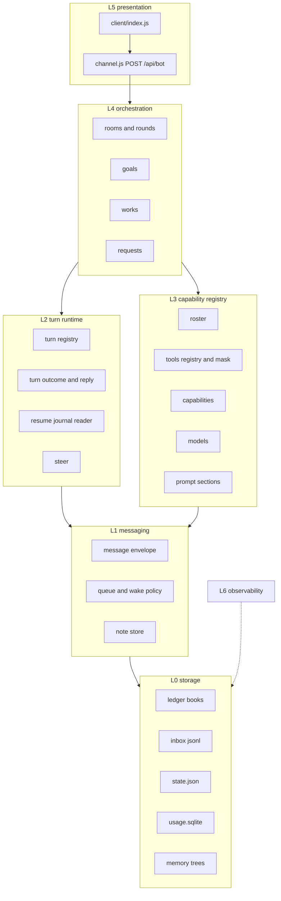
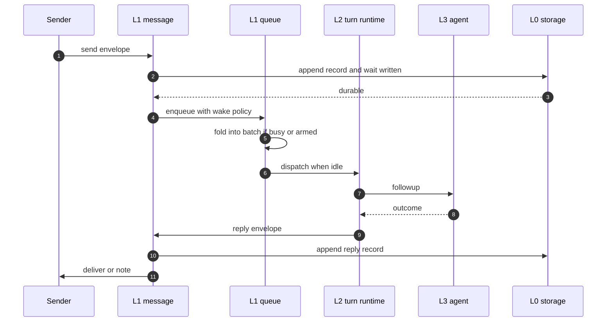

# DS-Bot: architecture blueprint

Scope: the message → turn → reply path in `ds-bot/`, read from the working tree at `4ae31552` (one uncommitted 4-line change in `handoffs.js`, one untracked `task-ledger.js`; neither is load-bearing). Citations are `file:line` relative to `ds-bot/`. Read-only survey; no tracked file was touched.

The system is 49 modules installed in one order (`index.js:64`), each `install(rt)` mutating one shared `rt` object (`index.js:87`, `store.js:585-590`, `turns.js:1348`, `delivery.js:381`, `tools.js:1454`). Everything below is a consequence of that.

---

## 1. Current state map

### 1.1 One message, end to end

A Bot or the user asks for something; `tools.js` turns it into `rt.deliver(...)`.

1. **Record before send.** For a real exchange (`role` in `request|reply|stopped`, `delivery.js:83`) the pair book is written first: `rt.ledger.append(book, …)` then `await rt.ledger.written(book)` (`delivery.js:160-164`). A message the book cannot keep is not sent. Messages with no Bot sender fall back to `state.exchanges` after the send (`delivery.js:216-229`).
2. **Silent notes go to the mailbox.** `if (silent) await rt.inbox.append(toId, …)` (`delivery.js:168-180`) writes `<home>/inbox/<botId>.jsonl` (`inbox.js:52`, `:96`).
3. **Capabilities are attached on the way out.** `await rt.ensureCapabilities(targetSessionId)` (`delivery.js:181` → `capabilities.js:423-437`).
4. **The transport peeks at the turn runtime.** `const busy = rt.live.get(targetSessionId)?.turn !== undefined` (`delivery.js:195`), then `const arming = flushTimers.get(targetSessionId) !== undefined` (`delivery.js:198`).
5. **Fold or dispatch.** `if ((busy || arming) && plainRelay({…17 fields…}))` (`delivery.js:199`, predicate at `backlog.js:31-50`) pushes onto `waiting`, arms a timer, and **returns the exchange id without delivering anything** (`delivery.js:200-206`). Otherwise `agent.steer` | `agent.send(msg,'next-turn',false)` | `agent.followup` (`delivery.js:208-210`), `await ctx.sessions.flush(agent.session)` (`:211`), then a `delivered` mark (`:212-215`).
6. **The turn runs.** `turns.js` listens on `ctx.on('session/event')`, keeps `live` (`turns.js:206`), and claims the trigger (`turns.js:510`); `expectsReply = info => info.role==='request'||info.role==='stopped'` (`turns.js:454`).
7. **The reply.** `turn/end` (`turns.js:1060`) computes the text (`:1074-1186`), then `answerSender` (`turns.js:42`) calls `rt.deliver({role:'reply', replyTo, exchangeId})` (`:57-68`). An empty body returns before that (`turns.js:55`).
8. **Batches flush.** `ctx.on('agent/status')` arms the quiet window only when the Session goes idle (`delivery.js:294-301`); `flushWaiting` merges through `mergeBacklog` (`delivery.js:244` → `backlog.js:75-99`) and sends one message whose `source.exchangeIds` are the folded ids (`delivery.js:253`).
9. **Crash safety is bolted on top.** `resume.js` replaces `rt.deliver` with its own wrapper (`resume.js:175-191`) so every delivery is first appended to `inflight.json` (`:116`, `:130-146`) and replayed at start (`:426-472`).

Writers, in order: ledger (`delivery.js:162`) → inbox (`:169`) → in-memory `waiting` (`:200`) → DSH Session (`:210`) → delivered mark (`:213`) → `state.exchanges` (`:226`) → `inflight.json` (`resume.js:184`). Five stores, six write sites, one message.

### 1.2 Module inventory

26 modules mapped: the 20 installed host modules on this path, the 2 entry points, the 3 shared libraries (`backlog.js`, `files.js`, `constants.js`) and the browser half. The other 29 of the 49 installed modules (`index.js:64`) — browser, mobile, im, office, learning, secrets, connectors, … — are verticals that hang off the same `rt`.

| Module (LOC) | Responsibility | In | Out | State on disk |
|---|---|---|---|---|
| `index.js` (97) | install order, `rt` construction | — | all 49 | none |
| `entry.js` | plugin `name`/`inject` (`:3-4`) | — | DSH | none |
| `store.js` (635) | team state, migrations, session indexes | `files`, `home-lock` | `rt.save()` everywhere | `state.json`, `state.lock` |
| `ledger.js` (175) | append-only JSONL books | — | none | `ledger/<book>.jsonl` |
| `inbox.js` (167) | note mailbox, read cursor | — | none | `inbox/<bot>.jsonl`, `.cursor.json` |
| `backlog.js` (100) | pure fold rule | — | none | none |
| `delivery.js` (382) | the send funnel + its own timer | `constants`, `text`, `backlog` | `turns.live`, `ledger`, `inbox` | none (memory only) |
| `turns.js` (1349) | live turns, reply routing, waiters | `diagnostics`, `usage`, `schedules` | `delivery`, `groups`, `goals` | none |
| `resume.js` (488) | inflight notes, replay, reconcile | `turns`, `text` | wraps `rt.deliver` | `inflight.json` |
| `steer.js` (276) | cancel + re-queue a running turn | `constants` | agent controller | none |
| `groups.js` (2007) | rooms, rounds, room log, prompts | `claims`, `tools`, `turns`, `ledger` | `rt.deliver` (`:789`, `:1951`) | `ledger/group-*.jsonl` |
| `goals.js` (809) | goal state machine, relay | `tools` | `rt.deliver` | inside `state.json` |
| `handoffs.js` (449) | works (delegated tasks) | `task-ledger` | `rt.deliver` | `ledger/` + `state.works` |
| `requests.js` (141) | request/question cards | `text` | `rt.deliver` | `state.requests` |
| `roster.js` (1024) | Bot CRUD, engines, secrets notes | `constants`, `text` | `rt.deliver` (`:479`) | `state.bots` |
| `tools.js` (1455) | 32 team tools, masking, refusals | `inbox`, `claims`, `folders` | `rt.deliver` (`:390`) | none |
| `capabilities.js` (545) | MCP mounts per Session | `secrets`, `store` | agents | mount config |
| `models.js` (424) | per-Bot model, retry policy | `text` | LLM route | `state` |
| `prompt.js` (141) | 8 fixed prompt sections | — | system prompt | none |
| `memory.js` (1798) | memory trees, journal, review | `files`, `models`, tools | `rt.deliver` | `memory/**`, `journal.jsonl` |
| `parts.js` (1883) | conversation parts, search | `btw`, `models`, `resume` | client view | `chat-index.sqlite` |
| `channel.js` (937) | `POST /api/bot` (`:918`) | `parts`, `btw`, `side` | client | none |
| `usage.js` (653) | metering, sqlite rows | — | — | `usage.sqlite` |
| `files.js` (27) | `replaceFile` — the only atomic write | — | store | — |
| `constants.js` (105) | 32 tool names, routes, timeouts | — | everyone | — |
| `client/index.js` (1311) | browser UI, 107 files | `channel` | DSH slots | `localStorage` |

`backlog.js` and `inbox.js` have zero inbound deps: the fold rule and the mailbox are already pure-ish. Everything else depends on `rt` implicitly.

### 1.3 Patch-point audit

Each row is a shipped feature that became a conditional in an existing path.

| Feature (commit) | Site | Concept that is missing |
|---|---|---|
| Persistent inbox for quiet notes (`b9533f42`) | `delivery.js:168-180`, plus `:209` **still** queues the same note for the next turn | **One durable home per note.** A note is stored as data and delivered as traffic; dedupe by `exchangeId` (`inbox.js:101-105`) and the prompt rule "every turn starts with `read_inbox`" (`prompt.js:27`) exist only to hide the double path |
| Coalescing (`802c9cce`) | `delivery.js:199`; the decision is 13 deny-rules in `plainRelay` (`backlog.js:36-48`) | **A message class.** Foldability is a property of the class, not a hand-maintained deny-list; every new option forces a new line (`queue:true`, `backlog.js:43`) |
| Count only unseen folded messages (`d98cd5c7`) | `backlog.js:91` `hidden = batch.slice(0,-1).filter(e => e.role !== 'reply').length` | **A recipient visibility model.** "Already seen" is derived from roles in a batch, not from the reader's own cursor |
| Empty answer must not wake (`d04cc50f`) | `turns.js:55` — 4 lines, `if (late === undefined && long === undefined && body.trim() === '') return` | **A turn outcome type.** "Ended with no text" is a legal result; testing `body.trim()` inside the sender is the symptom |
| Note landing in the quiet window (`eaea1cae`) | `delivery.js:198` `arming` + `:205` double-branch of `deadline`/`quiet` | **A wake policy owner.** Transport asks "is a turn live?" by reading another module's map (`:195`) and "is a timer armed?" from its own (`:198`) |
| Inflight notes across a kill (`cde34ed8`) | `resume.js:175-191` monkey-patches `rt.deliver` after the fact | **A delivery journal.** Durability is a property of the queue, not a wrapper installed by the last module that loads |
| Skill counting (`9b69b0e2`) | `dev/metrics.mjs:160`, `:171`, `:185` — no host module | **An observability layer.** The host emits no counters, so every "did Bots actually use skills" question is answered by a dev script replaying logs |

Not a patch, same disease: `headerFor` (`delivery.js:57-79`) is a 12-branch display template that also *encodes* delivery semantics. `deferred`, `retried`, `resumed`, `abandoned` have no type; they exist only as strings in a header the model reads and as flags in a 27-key options object (`delivery.js:124`).

The test file names mirror the patch list (`delivery-coalesce.test.js` has one test per rule, `test/delivery-coalesce.test.js:117-232`). Each rule is pinned, none is explained.

---

## 2. Target layering

### 2.1 Layers

| Layer | Single responsibility | Interface upward | Invariant |
|---|---|---|---|
| **L0 storage** | bytes on disk and nothing else | `read(key)`, `append(book, record)`, `written()` | A record is durable before any consumer sees it (`ledger.js:104-128`, `inbox.js:119-123`) |
| **L1 messaging** | one message type, one queue, one wake policy | `send(envelope) -> Promise<id>`, `pending(sessionId)`, `onWake(sessionId)` | A message has exactly one durable home; `send` never silently swallows (today `delivery.js:206` does) |
| **L2 turn runtime** | a turn is a unit with a start, an outcome and a reply | `outcome(sessionId)`, `reply(outcome)` | A turn ends exactly once with a typed outcome; no text ⇒ no wake is the runtime's rule, not the caller's |
| **L3 capability registry** | what an agent *can do*: tools, models, mounts, prompt sections | `toolsFor(sessionId)`, `modelOf(botId)`, `promptFor(botId)` | Registry reads state; it never sends messages |
| **L4 orchestration** | who talks to whom, in what order: rooms, goals, works, relay | `round(room)`, `advance(goal)`, `handoff(work)` | Orchestration may *ask* L1 to send; it may not write L0 directly |
| **L5 presentation** | render and accept input | `view()` / `call(endpoint)` (`channel.js:918`) | UI reads snapshots; it never mutates state |
| **L6 observability** | count and expose what happened | `count(event)`, `query(range)` | Append-only, read from L0 records, never from render code |

### 2.2 Mapping and splits

Today → target, with the splits:

- `delivery.js` splits into **`message.js`** (the envelope: role, replyTo, room, audience, and a `class` replacing the 17 fields `plainRelay` must inspect, `delivery.js:199`, `:108-124`), **`queue.js`** (`waiting` + `flushTimers` + `arm`, `:22-51`, `:236-284`), **`waker.js`** (owns both `busy` and `armed`, so `:195` and `:198` become one call), and **`say.js`** (`headerFor`, `:57-79`).
- `turns.js` splits into **`turns.js`** (registry: `live`, `claimTrigger`, `:206`, `:510`) and **`outcome.js`** (`replyText`, `groupReply`, `finish`, `:1179-1245`; the empty guard becomes `outcome.text === undefined` at one site).
- `groups.js` splits into **`room-log.js`** (the book: `keepGroupLine` `:268`, `append` `:287`) and **`round.js`** (`runRound` `:1046`, `memberTurn` `:1082`); `roomTurn`'s direct `rt.deliver` (`:789`) becomes an L4→L1 call with no transport knowledge.
- `store.js` splits into **`state.js`** (load/save/`readOnly`), **`migrate.js`** (`adopt`, `:112-272`) and **`sessions.js`** (the four owner maps, `:463-521`).
- `resume.js` stops wrapping `rt.deliver` and becomes a **consumer of the queue's journal** (`resume.js:175-191` deleted).
- `tools.js` splits into **`tools/registry.js`** (the 20 `rt.teamTools.push` sites, `:117-1418`) and **`tools/mask.js`** (`syncScopedTools` `:936`, `HIDDEN_TOOLS` `:28`).
- `capabilities.js`, `models.js`, `prompt.js`, `roster.js` become L3 as-is; `goals.js`, `handoffs.js`, `requests.js` become L4 as-is.

### 2.3 Target layering

### 2.4 One message across layers

---

## 3. Migration plan

Every step keeps `npm test` (210 files, `package.json` scripts), `--check` and `lint` green, and touches no client file.

| # | Step | Files | Proves |
|---|---|---|---|
| 0 | Freeze behaviour: add a table-driven test for `plainRelay` (`backlog.js:31-50`) enumerating all 13 reject rules | `test/backlog.test.js` | new test |
| 1 | Extract the envelope: `deliver`'s 27 keys → `message.js` with `class` (note, request, reply, room, steer) and explicit flags; `deliver` keeps its signature and delegates | new `src/host/message.js`, `delivery.js` | `delivery-coalesce.test.js`, `bot-messages.test.js` |
| 2 | Extract queue + waker: move `waiting`, `flushTimers`, `arm`, `flushWaiting` (`delivery.js:22-51`, `:236-301`) into `queue.js`; one `state(sessionId)` call replaces `:195` + `:198` | new `src/host/queue.js`, `delivery.js`, `turns.js` (drop `live` read) | `queue-next-turn.test.js`, `delivery-coalesce.test.js` |
| 3 | **One home per note**: `silent` branch stops calling `agent.send` (`delivery.js:209`); the note store publishes to the queue as non-waking; `inbox` dedupe (`inbox.js:101-105`) becomes a plain insert | `delivery.js`, `inbox.js`, `queue.js` | `inbox.test.js`, `queue-next-turn.test.js` |
| 4 | Journal: queue writes its own `inflight.json`; delete the `rt.deliver` wrapper (`resume.js:175-191`) | `queue.js`, `resume.js` | `delivery-coalesce.test.js` `:232`, `follow-through.test.js` |
| 5 | Turn outcome type: `turns.js` returns `{ text?, long?, late? }`; `answerSender` guard (`turns.js:55`) becomes `outcome.text === undefined` | `turns.js`, new `outcome.js` | `turns-reply.test.js`, `turn-error.test.js` |
| 6 | Fold rule by class: `mergeBacklog` counts from the batch's own `unseen` field instead of `backlog.js:91` | `backlog.js`, `queue.js` | `backlog.test.js`, `backlog-delivery.test.js` |
| 7 | Split `groups.js`: room log out of rounds; `rt.deliver` calls go through `queue.send` | `groups.js`, new `room-log.js` | `groups.test.js`, `room-races.test.js`, `drain.mjs` |
| 8 | L6: host counters for turns, folds, empty outcomes; `dev/metrics.mjs` reads them instead of recomputing (`dev/metrics.mjs:160`) | `usage.js`, `metrics.mjs` | `usage.test.js` |

### 3.1 Patches that disappear

- `delivery.js:209` silent double-route, and with it `inbox.js:101-105` dedupe as a load-bearing rule (step 3).
- `prompt.js:27` "every turn starts with read_inbox" stops being the only way a note is seen; it stays as a preference, not a correctness requirement (step 3).
- `delivery.js:198` `arming` and the `deadline`/`quiet` double-branch at `:205` (step 2).
- `backlog.js:91` role-based counting (step 6).
- `turns.js:55` empty-body test (step 5).
- `resume.js:175-191` deliver wrapper (step 4).

### 3.2 First step

**Step 1, envelope only.** Mechanical, no behaviour change, and steps 2-6 then think in classes instead of flags. `deliver`'s option list (`delivery.js:108-124`) is already a type; it is just written as a destructuring pattern in a 27-parameter function.

---

## 4. Risks and non-goals

**Must not break.**

- **Plugin contract.** DSH loads `plugin.js:8-10`, which imports the host *inside* `apply` so a broken host fails activation, not import. `name`/`inject` are the public surface (`entry.js:3-4`). No host module may import from the DSH install.
- **Generated client.** `client.js` is built from `src/client/` (`AGENTS.md` rule 4); every host change must leave `node scripts/build-client.mjs --check` clean. No migration step touches client code.
- **Event shapes.** `turns.js` and `resume.js` key off `turn/start`, `session/event`, `agent/status`, `agent/inbox/discarded` (`turns.js:1060`, `delivery.js:294`, `resume.js:199`, `:209`). These are DSH's, not ours; the layering must adapt to them, not the reverse.
- **Session log compatibility.** `resume.js:31-58` parses existing Session events; `store.js` is `version: 1` with in-place migrations (`store.js:106`, `:112-272`). A new `message.js` must serialize to the same `source` keys (`delivery.js:138-155`) or old Sessions stop replaying.
- **Tool names.** The 32 names in `constants.js:74-81` are in prompts and tests; the split of `tools.js` must not rename any.

**Non-goals.** No new database for messages (JSONL + ledger already is one). No rewrite of `groups.js` round semantics. No client framework change. No `state.json` shape change in this pass; migrations stay inline until `migrate.js` exists.
