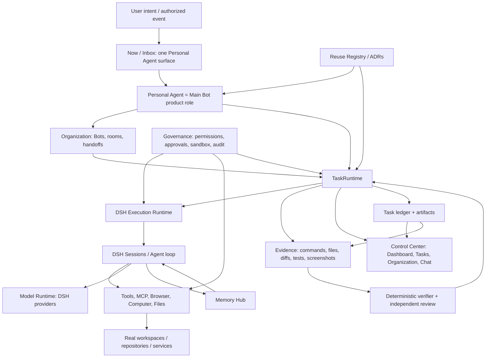
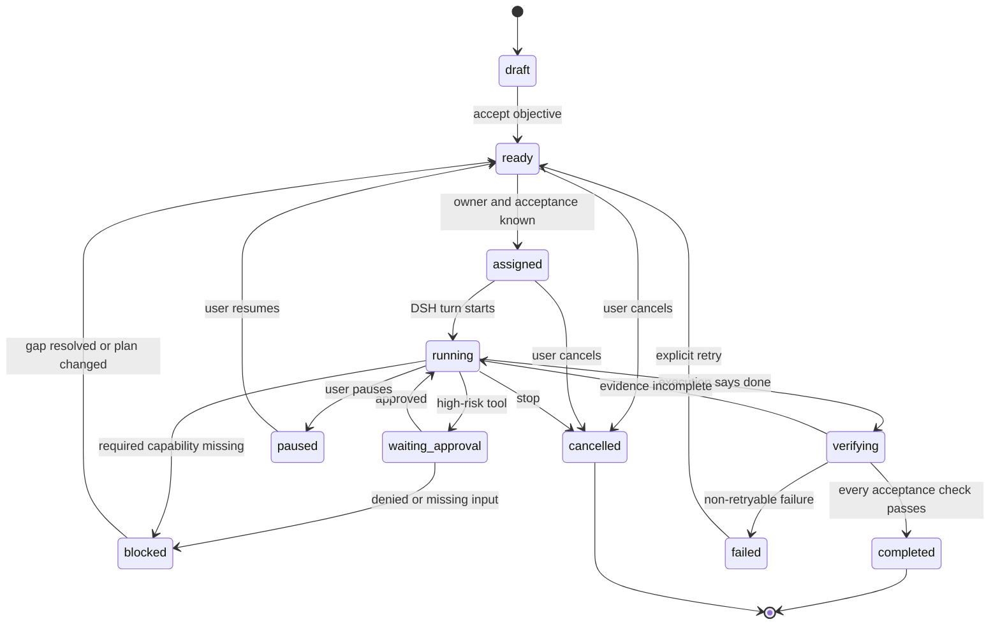

# DS-Bot 个人 AI 操作系统：Personal Agent 的真实任务架构

- 状态：设计基线，供后续分阶段实施
- 日期：2026-11-16
- 基线：DS-Bot `0.3.6`，本地提交 `26228dfa`；产品固定 DSH `0.2.2-rc.1`
- 关联：[架构决策](../../ARCHITECTURE_DECISIONS.md)、[复用矩阵](../../CODE_REUSE_MAP.md)、[现有消息架构](architecture.md)、[Agent 对比](agent-comparison.md)

## 0. 第一性原则：Personal Agent 是产品，Bot 团队是执行底座

DS-Bot 的需求基础不是“再做一个更会聊天的 AI”，也不是“把效率工具包装成 Agent”，而是消除从意图到结果之间的人类摩擦：切换设备、重新解释上下文、记住后续动作、盯着长任务、以及在不同软件之间搬运信息。

因此 V1 的产品主体是一个 **Personal Agent**：

1. **一个稳定关系。** 用户面对的是一个有长期记忆、可纠正、可追责的个人 Agent；Main Bot 是这个 Agent 的产品身份。专业 Bot、群聊和交接是它调用的内部组织能力。
2. **四种输入。** 用户主动意图、用户创建的定时任务、用户明确授权的环境事件，以及未完成任务的后续进展，都必须进入同一套任务生命周期。
3. **一个信任闭环。** 任何有影响的动作都遵循“计划 → 预览/批准 → 执行 → 进展 → 验证 → 尽可能撤销/回滚”。用户不需要阅读 Bot 的思维过程，但必须能看见系统准备做什么、做到哪、为什么算完成。
4. **一个真正的入口。** 入口不是唯一的聊天框，而是任何意图或事件被接住之后进入的统一界面：用户可以直接说，系统也可以在有权限、有预算、有退订方式的前提下主动提示。
5. **上下文不是全量监控。** 上下文能力来自用户授权的事件、明确范围内的记忆、可追溯的历史和按需读取的文件；不把“记录一切”当作 Personal Agent。

这条原则不废弃已有能力。Bot 团队、群聊、任务树、浏览器、电脑操控、连接器、记忆和审批都可以保留，但都要回答同一个问题：**它们是否让一个 Personal Agent 更可靠地承接用户的真实摩擦？** 不能回答的功能，不进入 V1 主路径。

### 0.1 产品的非目标

- 不要求用户先理解 roster、group、handoff 和 TaskRuntime 才能获得价值。
- 不以主动行为次数、消息数、Bot 数或 Token 消耗作为成功指标。
- 不把全量截屏、全量录音、传感器持续采集当成上下文能力的默认实现。
- 不为了“本地化”在 DS-Bot 内重造模型推理引擎；V1 的本地优先边界是数据、记忆、权限、审批和执行证据，模型路由仍属于 DSH。
- 不把未经验证的自动执行包装成“省心”。没有信任闭环的自动化越多，产品越不可用。

## 1. 目标

DS-Bot 的目标不是“增加更多 Bot 功能”，而是成为一个能承接强模型的 Personal Agent 操作系统：

1. 用户只提出目标，系统能形成可执行任务。
2. Main Bot 组织专业 Bot，并把任务交给合适的执行者。
3. 每个任务在真实 DSH Session、真实工具和真实工作区中完成。
4. 完成判定必须来自命令、文件、测试、页面或其他可复核证据，不能来自 Bot 自报。
5. 进程重启、会话切换、上下文压缩之后任务仍能继续。
6. 记忆、权限、工具、模型和任务都只有一套统一入口。
7. 系统能从真实失败中发现能力缺口，经过研究和测试后形成新 Skill 或 Adapter。
8. 用户在第一次使用时不必先组建团队，就能得到一个有稳定身份、能持续跟进的 Personal Agent。
9. 系统可以在用户明确授权后由事件触发，而不是只会等待下一条 Prompt。
10. 用户能随时看见计划、进展、审批、证据和失败恢复路径，并能够停止或撤销可逆动作。

这里的“AGI”指产品能力方向：让系统像可靠的通用数字同事一样长期工作。它不承诺从零训练 AGI 模型，也不把多 Agent、长提示词或插件数量当作 AGI 证明。

## 2. 非目标

- 不在 DS-Bot 内再造 Hermes、OpenCode、Pi、Goose 或 LangGraph Runtime。
- 不默认部署 PostgreSQL、Redis、Temporal、OpenViking、向量数据库或 Kubernetes。
- 不把所有页面做成静态 Dashboard；控制中心必须读取真实快照。
- 不把 Mock 模型的通过当作真实任务完成。
- 不自动修改生产环境、权限、密钥或发布路径。
- 不为“未来可能需要”预建微服务和通用平台抽象。

## 3. 当前机器与运行环境

| 项 | 实测值 | 架构含义 |
|---|---|---|
| 主机 | MacBook Pro `Mac17,8`，Apple M5 Pro，18 核 | 足够运行单机多 Session 和多 Bot；不需要为算力先拆分服务 |
| 内存 | 64 GiB | 可并行若干 DSH Session，但不应无限并发模型和浏览器 |
| 磁盘 | 926 GiB，剩余约 32 GiB，使用率 97% | 不引入重型容器/向量库；运行产物必须可清理、可归档 |
| macOS | 27.0.1 | 桌面端是首要真实环境 |
| Node | v26.12.1 | 与现有 DS-Bot/DSH 工具链兼容；CI 仍以锁定依赖为准 |
| Git | 2.56.0 | worktree、diff、提交证据可直接用于任务验收 |
| SQLite | 3.54.0 | 本地任务索引、聊天索引、usage 足够，不需要默认数据库服务 |
| 全局 DSH CLI | `0.2.2-rc.3` | 与产品固定的 `0.2.2-rc.1` 有版本漂移；不能把全局 CLI 当产品基线 |
| Codex | 0.162.1 | 可作为本地执行 Bot，不成为 Runtime |
| Claude Code | 2.1.323 | 可作为本地执行 Bot，不成为 Runtime |
| OpenCode | 2.1.4 | 可作为本地执行 Bot，不成为 Runtime |
| Pi | 0.84.3 | 可作为本地执行 Bot，不成为 Runtime |
| Goose | 未安装 | 不作为当前执行依赖 |
| PostgreSQL/Temporal | 未安装 | 默认不引入；在实测证明需要前保持本地任务系统 |
| Redis | 已安装但未作为默认服务 | 只用于未来已批准的外部适配，不进入默认启动链 |
| Docker | 已安装 | 仅用于隔离实验，不作为默认产品运行依赖 |

## 4. 总体架构



### 4.1 单一权威边界

| 权威 | 所有者 | 不允许出现 |
|---|---|---|
| Agent Runtime | DSH | Hermes/OpenCode/Pi/Goose 的第二套 loop |
| Bot 身份与权限 | DS-Bot | 第二套 roster 或 permission engine |
| 组织协作 | DS-Bot `groups` / `handoffs` | 另一套群聊/task roster |
| 任务语义 | DS-Bot `TaskRuntime` | 只看聊天文本推断任务完成 |
| 执行状态 | DSH Session + DS-Bot task evidence | UI 自建状态 |
| 记忆写入 | DS-Bot `memory.js` | 另一个默认 memory authority |
| 工具注册 | DSH tool registry + MCP | 模块私有工具注册表 |
| 模型调用 | DSH LLM provider | LiteLLM/其他 gateway 的重复路由 |
| 审计证据 | append-only ledgers + artifacts | 只存在前端内存的状态 |

DSH 是可变底座，不是永远冻结的第三方黑盒。通用 Session、Turn、Tool、UI 契约优先在 DSH 仓库形成版本化改动；Bot 团队、产品语义和控制中心留在 DS-Bot。任何跨仓改动都必须有独立 DSH 分支、同步锁定版本、跨仓测试和回滚路径，而且仍然不能引入第二套 Agent Runtime。

### 4.2 Personal Agent 闭环

1. **接住**：用户主动输入，或一个已经获授权的事件进入 `Now / Inbox`。系统先判断这是问题、任务、提醒还是仅需记录，不要求用户选择内部 Bot。
2. **补上下文**：只读取本次意图所需、当前调用者有权读取的记忆、历史、文件和连接器数据；无法确定的关键事实先询问，不靠猜测补全。
3. **形成计划**：Personal Agent 给出可检查的结果目标、动作范围和风险点。可逆的低风险动作可以按用户预设直接执行；外部副作用、权限、付款、删除和不可逆操作必须进入批准。
4. **执行与汇报**：内部需要时可以组织多个 Bot，但对外保持一个任务叙事。长任务定期汇报真实进展；用户停止时立即停下并保留现场。
5. **验证与收尾**：完成必须有证据，不以 Bot 自报为准。结果要进入正确的作用域，只有验证过的结果才可以进入长期记忆。
6. **可撤销性**：可逆动作保留撤销路径；无法撤销的动作必须在批准时明确说明。失败要给出真实原因和恢复选项，不伪造成功。

团队界面是这套闭环的观察窗和控制器，不是用户必须经过的工作流。`Organization` 页回答“谁在做”，`Tasks` 页回答“做到哪、是否完成”，`Chat` 回答“为什么、下一步是什么”，`Now / Inbox` 回答“现在需要我做什么”。

## 5. 运行配置

默认是一个**本地模块化单体**：一个 DS-Bot/DSH Host 进程族负责产品、Bot 组织、任务和 UI；SQLite/JSONL/文件系统负责持久化；外部服务只是可选 Adapter。

### 5.1 Profile 配置

| Profile | 用途 | DSH_HOME | 模型 | 是否用于 CI |
|---|---|---|---|---|
| `mock-ci` | 可重复契约验证 | 仓库内 `.dsh-test-aios-<run>` | `dev/mock-llm.mjs` | 是 |
| `live-local` | 本机真实任务 | 独立产品 DSH_HOME，不指向用户现有数据 | DSH 已配置的真实 Provider | 否 |
| `live-worktree` | 真实代码/测试任务 | 独立 DSH_HOME + 独立 Git worktree | 真实 Provider | 手动/计划任务 |
| `packaged` | Electron 产品运行 | app 自己的 profile 和 DSH_HOME | 用户配置 | 发布验收 |

硬规则：

- 测试永远不读取或写入 `~/.dsh`。
- 真实任务不直接在主工作树运行；先创建专用 worktree。
- `mock-ci` 与 `live-*` 的证据分开保存，不能合并成“任务已完成”。
- `dsh` 全局 CLI 版本只用于环境观察；产品测试以 `dev/harness/package.json` 和 app 锁定版本为准。

### 5.2 端口与进程

- Mock bench：Web 端口和 Mock LLM 端口都从空闲端口动态选择，避免固定端口冲突；仓库现有约定中的 `31x0/88x0` 仍可用于人工调试。
- 真实任务：使用独立 DSH profile，启动后记录 Web URL、进程组、开始时间、DSH 版本和 Git commit。
- 每个 bench/任务结束都必须停止自己启动的进程，记录 PID/进程组清理结果。
- 不允许通过进程名 kill；只停止本次运行持有的 PID/进程组。

### 5.3 存储

```text
<repo>/.dsh-test-aios-<run>/       mock 或 live 的隔离 DSH_HOME
<repo>/.aios-runs/<run-id>/       任务运行包
  manifest.json                   输入、版本、环境、模型模式
  events.jsonl                    追加式任务/执行事件
  artifacts/                      日志、截图、diff、测试结果
  evidence.json                   机器可读的完成证据
  result.json                     最终状态、失败原因、重试与人工介入
```

默认不使用数据库服务：

- 现有 `state.json` 继续保存 roster、rooms、goals、handoffs 等产品状态。
- `task-ledger` 继续作为追加式任务生命周期记录；TaskRuntime 先读它和现有记录，不建立第三套任务真源。
- `usage.sqlite`、`chat-index.sqlite` 继续作为专用索引。
- 如果需要快速控制中心查询，先尝试内存缓存或 SQLite 派生投影；投影必须可以删除重建。
- 运行产物默认保留 14 天；清理只作用于 `.aios-runs/` 和本次创建的 `.dsh-test-aios-*`，永不清理用户真实数据。

### 5.4 模型与成本

- 默认模型仍由 DSH Provider 解析，DeepSeek 优先。
- Personal Agent 的本地优先边界是**数据、记忆、权限、审批、调度与执行证据**，不是要求 V1 把全部模型权重放到本地。需要本地推理时，通过 DSH Provider 接入本地模型；DS-Bot 不新建一个与之竞争的路由器或推理引擎。
- Mock 模式只用于行为和契约测试，不代表真实模型推理质量。
- Live 模式使用用户已经配置在 DSH 的凭据；不把 key 写入任务文件、日志或 prompt。
- 每次真实任务记录：模型路由、输入/输出 token、缓存 token、耗时、重试次数和人工介入次数。
- 如果记录美元成本，只使用官方价格数据或明确标注的外部 provider 数据，不把估算值冒充账单。

### 5.5 并发

第一版默认：

- 同时运行的真实任务数：1。
- 同一 Bot Session：1 个执行中的 turn。
- 只读核查与写任务可以并行，但同一 Git worktree 不允许并行写。
- 浏览器和 Computer Use 继续使用单租约。
- 需要扩展并发时先增加资源观测和队列背压，不直接提高并发数。

## 6. 统一任务模型

TaskRuntime 是 DS-Bot 的产品任务边界，不是一个新 Agent Runtime。

### 6.1 核心对象

```ts
type TaskStatus =
  | 'draft'
  | 'ready'
  | 'assigned'
  | 'running'
  | 'waiting_approval'
  | 'blocked'
  | 'paused'
  | 'verifying'
  | 'completed'
  | 'failed'
  | 'cancelled'

interface TaskView {
  id: string
  schemaVersion: 1
  trigger: TriggerView
  contextRefs: ContextRef[]
  title: string
  objective: string
  acceptance: string
  status: TaskStatus
  revision: number
  parentId?: string
  goalId?: string
  roomId?: string
  ownerBotId?: string
  assignedBotIds: string[]
  blockedBy: string[]
  dependencies: string[]
  risk: 'read' | 'write' | 'external' | 'destructive'
  approvalIds: string[]
  evidenceIds: string[]
  undo?: {
    kind: 'file' | 'memory' | 'workspace' | 'external'
    ref: string
    available: boolean
  }
  attempt: number
  createdAt: number
  updatedAt: number
  nextAction?: string
}

interface TriggerView {
  kind: 'user' | 'schedule' | 'event' | 'follow_up' | 'unknown'
  source: string
  grantId?: string
  eventId?: string
  receivedAt: number
}

interface ContextRef {
  kind: 'memory' | 'session' | 'file' | 'connector'
  id: string
  scope: string
  sha256?: string
  frozenAt: number
}

interface EvidenceView {
  id: string
  taskId: string
  kind: 'command' | 'test' | 'file' | 'diff' | 'artifact' | 'ui' | 'human_review' | 'session'
  source: string
  summary: string
  command?: string
  exitCode?: number
  artifactPath?: string
  sha256?: string
  sessionId?: string
  eventSeq?: number
  createdAt: number
}
```

### 6.2 状态机



规则：

- `trigger` 和 `contextRefs` 是任务来源证据，不是新的任务正文；它们回答“谁把任务带进来”和“Agent 当时依据了哪些授权上下文”。旧记录无法证明来源时标为 `unknown`，不能事后猜成用户输入。
- 由环境事件创建的任务必须带 `grantId`；没有授权记录的事件只能作为普通用户消息进入，不能直接创建主动任务。
- 审批结果与撤销能力通过稳定引用挂到任务上，不能只存在于 UI 内存或 Bot 自述里。
- **完成不是 Bot 状态。** 只有 verifier 在全部 acceptance checks 通过后写入 `completed`。
- 任务失败必须记录 `reason`、最后一次错误、已做尝试、可恢复动作和证据引用。
- 每次状态迁移都产生 append-only event，带 revision 和 actor（user、Main Bot、member Bot、verifier、system）。
- 任务可以重试，但每次重试是新 attempt，不覆盖旧证据。
- 任务暂停不取消正在运行的 DSH turn；停 turn 和暂停任务分别执行。

### 6.3 现有数据到 TaskView 的映射

第一阶段只读投影：

| 现有来源 | TaskView 映射 |
|---|---|
| `room.goal` stages/tasks | goal 父节点、stage 汇总节点、成员任务 |
| `handoff` work | 子任务、负责人、父任务、打开/关闭事件 |
| `ledger/tasks-<day>.jsonl` | 生命周期、pending/answered/abandoned、时长 |
| `board/archive/<bot>.jsonl` | delivery/decision/blocked 自报证据，不能直接算 done |
| `inflight.json` | running/recovery 候选 |
| Session events / issue ids | 证据来源、执行时间线 |
| usage.sqlite | token、模型、成本、调用次数 |

第二阶段写穿：

- 新任务动作同时写现有产品记录和 TaskRuntime event。
- 对比旧视图和新视图；不一致时阻塞升级，不自动改数据。
- 只有在迁移测试、重启测试和真实任务都通过后，TaskRuntime 才能成为统一写入口。

## 7. Chief 工作流

1. 用户给出目标，或一个已授权的 schedule/环境事件进入 `Now / Inbox`。
2. Personal Agent 记录触发来源，读取目标、作用域内记忆、现有任务和真实工作区状态；不要求用户重新解释已有上下文。
3. Main Bot 生成候选 `TaskView`：目标、验收、约束、依赖、风险、负责人候选。
4. 需要澄清时，只问一个会改变执行结果的问题；否则作可逆假设并记录。
5. TaskRuntime 检查触发器授权、依赖和权限，建立任务树；需要时生成一次低摩擦批准。
6. Main Bot 将 ready 任务派给专业 Bot。
7. 每个 Bot 通过 DSH Session 执行，使用统一工具和 Memory Hub。
8. 执行结果先产生 Evidence，再进入 verifying。
9. 独立 verifier（确定性命令优先；必要时另一个 Bot 复核）判断完成。
10. 通过后写入任务结果、项目记忆、后续行动和可撤销引用；失败则更新 nextAction/blocker 并继续或停止。

“Chief”不是第二个 Runtime，也不是独立数据库。它是 Main Bot 的产品角色 + TaskRuntime 的编排入口。

## 8. 证据优先的完成标准

任务完成必须至少有两类证据：

1. **执行证据**：DSH `turn/end`、tool result、命令输出或文件变更。
2. **验收证据**：与 acceptance 对应的测试、diff、页面截图、服务健康检查或人工确认。

禁止：

- 只看 Bot 最后一句“完成了”。
- 只看 token/turn 数。
- 只看 UI 中的绿色状态。
- 只看 `delivery` 自报行。
- 把 Mock 模式通过等同真实模型完成。
- 用临时假数据替代真实工作区或真实服务。

真实任务运行包中的 `evidence.json` 至少包含：

- 基线 commit 和工作树状态；
- 实际执行的命令、退出码、耗时；
- 变更文件和 diff 摘要；
- 测试名称与结果；
- 产物路径和 SHA-256；
- 重启/恢复次数；
- 外部副作用和审批记录；
- 人工介入原因与次数。

## 9. 双轨验证

### Contract lane：`mock-ci`

用途：每次代码变更、PR、CI。

- 固定 Mock 模型和固定输入。
- 检查消息、任务、权限、状态迁移和重启行为。
- 快速、可重复、无真实付费。
- 失败必须阻塞合并。

### Reality lane：`live-worktree`

用途：真实模型、真实仓库、真实工具链和真实环境。

- 每个任务在专用 worktree 中运行。
- 使用真实 DSH Provider、真实 CLI/浏览器/文件系统。
- 结果由 verifier 检查命令和产物。
- 同一任务至少重复 3 次，记录成功率、人工介入和副作用。
- 失败必须形成可复现证据，不能只记录“模型没做对”。

### 初始真实任务集

| ID | 任务 | 验收 |
|---|---|---|
| `R1` | 修复一个仓库中的真实失败测试 | 原测试先失败，改动后通过；无无关 diff |
| `R2` | 完成一个跨 host/client 的小功能并保持重启恢复 | host 测试、client 新鲜度、重启后状态一致 |
| `R3` | 完成 MCP loopback server 官方 SDK 迁移 | 官方协议、Bearer、工具调用和取消路径通过 |
| `R4` | 修正一条错误记忆并撤销一次整理 | 旧事实不再进入提示词；撤销恢复原文 |
| `R5` | 真实浏览器读取页面并给出可追溯证据 | URL、截图、抽取文本、失败重试记录齐全 |
| `R6` | 多 Bot 完成任务树，一个成员失败后重派 | 任务树、handoff、verifier 和最终证据一致 |
| `P1` | 一个获授权的本地事件进入 Personal Agent，补足已有上下文并产出可撤销结果 | 不重复解释；低摩擦批准；进展与停止可见；产物、证据、撤销和记忆写入均可验证 |

每个任务必须有 manifest；没有 manifest 的“演示任务”不算验收。

## 10. 权限与安全

风险分级：

| 风险 | 例子 | 默认 |
|---|---|---|
| `read` | 读文件、查 API、看网页 | 可自动执行，记录来源 |
| `write` | 修改 worktree、运行测试、生成文件 | workspace-write，必须可回滚 |
| `external` | 发消息、创建 PR、调用付费 API | 必须审批或明确授权 |
| `destructive` | 删除数据、重置生产、撤销密钥 | 禁止自动执行，必须人工确认 |

- DSH approval/permission preset 是唯一策略引擎。
- 触发器也属于权限，不只是一段调度配置：

| 触发来源 | 是否需要授权 | V1 默认 | 约束 |
|---|---|---|---|
| 用户当前输入 | 已由本次输入授权 | 允许 | 不跨作用域读取 |
| 用户创建的 schedule | 创建时授权 | 允许 | 可暂停/删除；重复触发有频率上限 |
| 本地文件/文件夹事件 | 首次绑定目录时授权 | 可试点 | 只监听显式目录；保留路径与事件摘要，不默认读全文 |
| 邮件、IM、手机传感器 | 连接器/设备授权 | 不作为首个 Reality Gate | 必须逐来源授权、脱敏、限频、可撤销 |
| Bot 间进展/交接 | 任务创建时授权 | 允许 | 只开必要轮次；纯确认和空结果不唤醒 |

- 主动性遵守“结果优先、打扰有预算”：没有新结果、风险变化或必须人工决定的事项，不主动开新一轮；同一来源有频率上限和静默时段。
- 每个 run 记录 sandbox、working directory、额外允许目录和审批结果。
- 启动真实任务前检查 Git worktree 干净，并保存 base commit。
- 任务结束必须保留 diff 和产物；清理只删除本 run 的临时目录。
- 日志默认脱敏 token、cookie、API key、绝对私有路径和 DSH_HOME 内容。

## 11. 可观测性和控制中心

Control Center 只读取稳定的 View model：

- Now / Inbox：当前需要用户处理的意图、事件、审批、结果和可恢复失败；这是 Personal Agent 的主入口。
- Dashboard：运行中任务、阻塞任务、最近完成、审批、系统健康、模型/节点状态。
- Chat：Main Bot 执行面板、工具活动、文件预览、当前任务。
- Organization：Bot 角色、团队关系、当前负载、最近交接。
- Tasks：树、看板、时间线、依赖、证据、审批、恢复。
- Memory：分类、来源、关系、版本、纠错。
- Skills/Tools/Models：能力、健康、成本、使用。
- Activities：任务、事件、失败和人工介入的统一时间线。

任何“实时数据”必须从 host/API 产生；Mock 数据必须带 `dataMode: 'preview'`，不能与真实状态混用。

## 12. 分阶段路线

每个阶段都必须形成可运行、可测试、可回滚的版本。

### Phase 0：Reality Harness

产出一个可在隔离 bench 中运行任务 manifest、记录触发器与证据、执行重启和输出 `result.json` 的 Reality Harness。

退出标准：

- Mock 任务可重复通过；
- 运行包完整；
- 服务清理可靠；
- 任务失败能给出明确证据；
- 能区分用户输入、schedule、本地事件和任务后续四种触发来源；
- 不读取真实 DSH_HOME。

### Phase 1：MCP officialization

把 `ds-bot/src/host/local-agents/mcp.js` 的手写 `2025-03-26` server 替换为官方 MCP server SDK，统一 DSH/DS-Bot client 版本。

退出标准：

- 官方协议握手；
- per-session bearer token；
- `tools/list`、`tools/call`、progress、cancel；
- 本机 Codex/Claude/OpenCode/Pi adapter 真实调用；
- 无重复 transport/auth 实现。

### Phase 2：TaskRuntime read model

从 goals、handoffs、task ledger、board、resume 和 Session events 生成统一 TaskView。

退出标准：

- 只读投影；
- 每个任务可追到来源；
- 现有行为不变；
- 重启可重建；
- Control Center 可读。

### Phase 3：TaskRuntime write-through

新任务动作通过一个入口写入，旧表面成为投影或只读证据。

退出标准：

- 任务状态迁移有 revision；
- 完成必须有 Evidence；
- 崩溃恢复不重复副作用；
- 真实任务 R1/R2/R6 通过。

### Phase 4：Control Center

基于现有 React shell 增加 Now / Inbox、Dashboard、Chat、Organization、Tasks 页面；Now / Inbox 先于完整组织管理页完成。

退出标准：

- 真实数据；
- 空/错/加载/审批/恢复状态；
- 一个用户不用进入 Organization，也能完成一次端到端 Personal Agent 任务；
- 桌面和窄屏截图；
- 不引入第二套导航、主题或权限检查。

### Phase 5：Memory Hub / Evolution

在不替换现有 Markdown 真源的前提下，把 Memory Hub 扩展成 Personal Agent 的受控上下文入口：记忆审计、纠错、来源、保留期和可选外部 Adapter 都通过同一权限边界；把真实失败沉淀为 Skill/Adapter。

退出标准：

- 记忆删除/纠错/撤销可验证；
- 新能力有来源、许可证、测试和 NOTICE；
- 能力提升有重复任务数据，不是主观判断。

### Phase 6：Execution Nodes

只有当单个 Mac 无法满足隔离、并发或运行环境需求时，才基于 DSH SSH/workspace 增加远程节点。

退出标准：

- 节点身份、健康、租约、任务迁移、断线恢复都有真实测试；
- 没有为“看起来先进”拆微服务。

## 13. 当前不引入的技术

| 技术 | 当前结论 | 重新评估条件 |
|---|---|---|
| Temporal | 不默认引入 | 本地任务恢复在重复真实任务中失败，且 journal/retry 无法修复 |
| LangGraph | 不引入 Runtime | 只作为 checkpoint/interrupt 测试语义 |
| LiteLLM | 不引入核心路由 | 已有外部 gateway，或 DSH 无法满足路由/预算需求 |
| OpenViking | 不默认启动 | 本地记忆/检索质量经真实任务证明不足，且外部服务许可证边界通过 |
| 向量数据库 | 不默认引入 | 关键词/BM25 在真实记忆任务中达不到验收 |
| PostgreSQL | 不默认引入 | 多节点/多用户写入和查询无法由 SQLite/文件安全满足 |
| Redis | 不默认引入 | 已有外部 gateway/队列需求并完成隔离和运维设计 |
| 第二桌面/多节点 | 不先做 | 单机隔离和并发经真实任务达到瓶颈 |

## 14. 最终完成标准

一个真实目标完成后，控制中心必须能看到：

- 目标、任务树和每个任务的负责人；
- 执行使用的 Bot、Session、模型、工具和 workspace；
- 关键审批和外部副作用；
- 命令、测试、文件 diff、截图等证据；
- 重启/重试/换方案的完整时间线；
- 任务是否真正完成，以及未完成时的下一步；
- 结果是否写入正确的记忆和项目上下文。

如果只能看到“Bot 说完成了”，这个系统就还没有达到目标。

## 15. Personal Agent Reality Gate

`R1`–`R6` 证明 DS-Bot 能可靠执行真实任务，但不能单独证明“Personal Agent”的产品命题。必须再有一个 `P1`，证明系统能接住一次并非来自聊天框的真实摩擦，并在不要求用户理解内部团队的情况下完成可信闭环。

### 15.1 `P1` 场景：文件到达后的上下文任务

用户预先授权 DS-Bot 监听一个明确的本地收件目录，并说：

> 以后这个目录里出现报价需求，就按我常用的报价格式和最新价格政策起草报价单。缺失关键价格或有效期时可以问我一次；不要对外发送。

验收任务：

1. 用户把一个真实的需求文件放入该目录，不额外发送 Prompt。
2. DS-Bot 产生一个带来源的 Personal Agent 事件：目录、文件哈希、发现时间、绑定授权。
3. Agent 读取需求文件，并只召回完成本任务所需的既有记忆、历史结果和价格政策；不要求用户重新解释“常用格式”和“价格政策”。
4. Agent 给出计划和风险点。写入文件属于 workspace write，必须可撤销；对外发送在批准范围内被明确禁止。
5. 用户通过一次低摩擦确认允许起草。执行过程中能看到真实进展，能停止；Agent 不在没有新结果时反复汇报。
6. Agent 生成报价文件，运行可执行的检查，报告产物路径、哈希和验收结果。
7. 验证通过后，只把本次真正可复用的偏好或决定写入正确记忆；需求文件正文、客户隐私和临时上下文不默认进入长期记忆。
8. 用户执行撤销时，只撤销本次创建的产物，不删除原始需求文件、不篡改既有用户文件。

如果 Agent 在关键价格或有效期上无法从授权上下文确定，它应当只问一次，并把问题合并成一个可回答的确认；不能连续追问用户已经提供过的信息。

### 15.2 必须记录的指标

| 指标 | 口径 | P1 目标 |
|---|---|---|
| 首次有用响应时间 | 授权事件发生到用户看到计划/首批产出 | 人工统计并记录 p50/p90；不以单次演示代替 |
| 重复解释次数 | 已存在于授权上下文、但 Agent 仍再次询问的次数 | `0` 个已提供事实 |
| 关键澄清次数 | 每个完成任务的必要澄清轮数 | `≤ 1` |
| 用户操作面 | 从事件到完成需要用户确认的次数 | `≤ 2` 次 |
| 完成率 | 有验收证据的完成次数 / 启动次数 | 真实任务重复运行后统计 |
| 人工接管率 | 需要用户修正计划、补权限或手工作业的运行占比 | 每次都有原因分类 |
| 误打扰率 | 没有新结果、风险变化或必要决策却主动通知的次数 | 目标 `0` |
| 撤销成功率 | 可逆动作被正确撤销且不伤及原数据的比例 | `100%` |
| 上下文来源可追溯率 | 进入计划的记忆/历史/文件均有来源引用 | `100%` |
| 周留存 | 完成过的用户在第 4 周仍以该入口发起或接收任务 | 真实用户数据，不用 Mock 宣称 |

### 15.3 V1 边界

- 首发 Reality Gate 只使用本地目录事件、用户创建的 schedule 和显式用户输入；邮件、IM、手机传感器等来源要等连接器、移动端推送、脱敏和撤销路径分别通过真实验收。
- `P1` 不允许对外发送、付款、真实发布或不可逆删除。它证明的是“接住摩擦并完成可撤销工作”，不是无边界的自动化。
- 本地模型不是 `P1` 的必需条件。必须本地优先的是用户数据、上下文作用域、审批、执行记录和可撤销性；模型调用遵守 DSH Provider 边界。
- `P1` 通过之前，可以使用“Personal AI OS 设计基线”这个说法，但不能对外宣称“Personal Agent V1 已完成”。

### 15.4 与现有 Reality Gate 的关系

`R1`–`R6` 是执行地基：它们证明 Session、任务、审批、证据、重启和团队交接可靠。`P1` 是产品地基：它证明用户不需要理解这些内部构件，也能感受到 Personal Agent 的价值。两者都通过，才构成 DS-Bot Personal Agent V1 的真实证据链。
